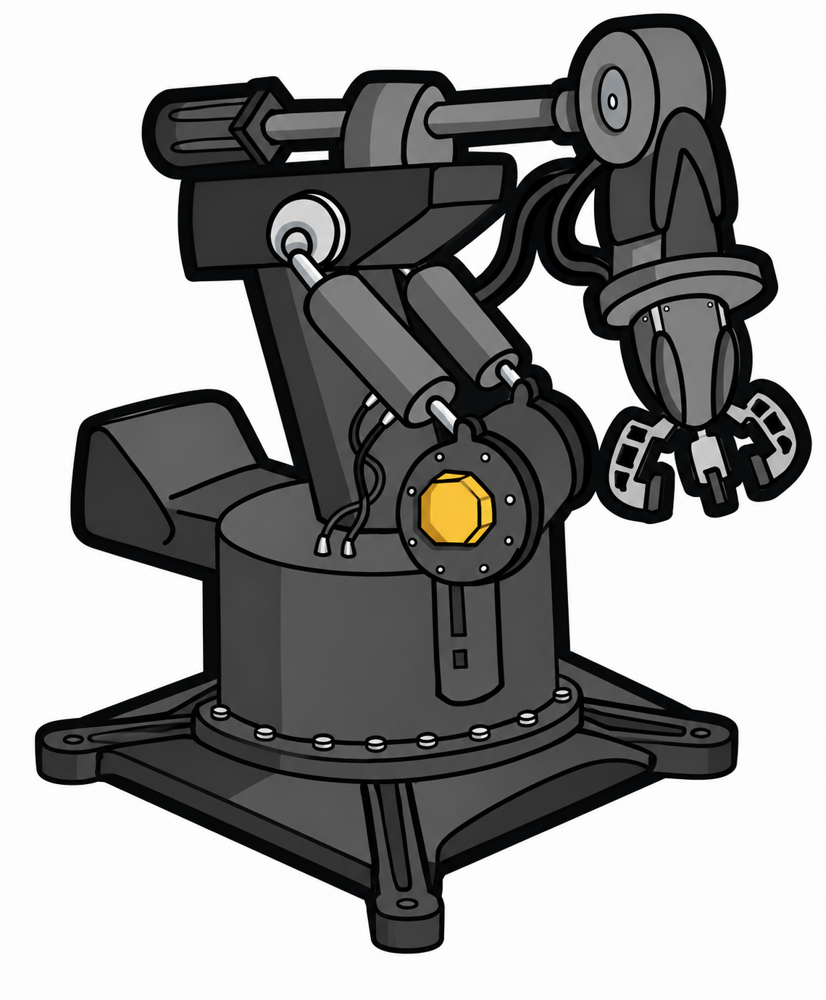

# Robotic Workbench

## Start the arm workbench

Install dependencies once (`uv sync --locked --extra vision --extra pwm` and `npm ci`), then run:

```sh
npm start
```

Open **http://127.0.0.1:5173** on the Pi or **http://<pi-address>:5173** on your LAN. The command starts all backend services and the dashboard. On first use, the dashboard opens **Initialization**. Use [Measuring the arm and entering measurements](#measuring-the-arm-and-entering-measurements) below to configure its geometry; minimum and maximum pulse limits are separate, optional constraints. Jog is available without geometry or saved pulse limits and requires manual power preparation and acknowledgment. PCA9685 automatic retrieval remains disabled.

The dashboard has no shared recovery panel. Diagnostics provides interrupted-session
cleanup and current-monitor reset. Controller recovery interlocks remain enforced;
general acknowledged recovery is available through `POST /coordinator/recover` after
inspection. See [Dashboard](apps/dashboard/README.md).

Use `npm run dev:mock` for a simulated stack. Press Ctrl+C or run `npm run stop` to stop. The stop command shuts down this checkout's hardware/mock services and dashboard, including orphaned processes, and force-kills any that do not exit. Logs and commissioning records live under `.runtime/hardware/` for hardware and `.runtime/mock/` for simulation. Existing `.runtime/hardware/workbench-config.json` settings are loaded automatically when present; otherwise the Pi defaults apply.

Startup preserves the installed Python dependencies with `uv run --no-sync`; rerun
the installation command above after dependency changes. If `WORKBENCH_CONFIG` still
points to a deleted `.runtime/hardware/workbench-config.json`, startup reports the
fallback to the mode's defaults. Other missing custom configuration paths remain errors.

`npm run stop` also writes and verifies full-off on every PCA9685 channel after the
processes exit, including when the stack is already stopped. This releases the arm;
it can fall under its own weight. A running mock-only stack never accesses physical
I2C. PWM shutdown failures return an error instructing physical servo-power cutoff.

## About the project

An on-premises assistant for retrieving tools: “Grab me the crescent wrench” becomes
a validated pickup sequence and delivery to a tray. Vision, voice, language interpretation,
coordination, arm control and the dashboard are separate applications in one monorepo.



*Robotic arm concept art.*

The normal launcher uses the **installed Pi hardware**. Simulation is available only
through `npm run dev:mock` or `--mode mock` for development and tests. Real
OpenCV, local speech/LLM and RoArm-M2-S adapters are included but require local models,
reference images and reviewed arm calibration. Physical pickup has not been validated.

## Raspberry Pi hardware direction

The selected build uses a **Raspberry Pi 5, Camera Module 3, Waveshare PCA9685 HAT,
ServoCity power board and DFRobot ROB0036 V2 arm**. The
[Pi implementation plan](PLAN.md) and [hardware guide](docs/hardware.md) describe
the owner's overhead control station, separate servo power and remaining setup.
The [current shopping list](docs/shopping-list.md) records quantities, product links,
accessories, price checks and purchasing decisions still to resolve for this build.

The Pi foundations now provide:

- A Picamera2 capture backend, alongside the existing OpenCV USB-camera backend.
- [Camera setup commands](apps/vision/README.md#camera-setup-without-the-service) for raw
  captures, region overlays, reference collection and validation before starting vision.
- Six-channel pulse validation, an offline pose checker and low-level PCA9685 output.
- [Manual joint controls](docs/manual-controls.md) in the **Jog** tab, with keyboard,
  browser Xbox controller and on-screen jogging. Base is channel 5 through claw on
  channel 0; physical control uses saved commissioning limits.
- Pi hardware defaults at `config/development/pi.json`.
- An [arm-control design and durable offline rehearsal](docs/arm-control.md) covering
  startup, bounded commands, independent simulated completion evidence, stop and recovery.
- [Commissioning notebooks and trial snapshots](docs/commissioning.md) for measured
  assignments, limits, reviewed poses and separate physical/simulated acceptance counts.
- [Pi deployment preparation](docs/pi-deployment.md): reviewable mock-only service
  bundles, configuration checks, read-only health inspection and lifecycle instructions.

**PCA9685 automated retrieval is not enabled.** The arm does not provide measured
joint feedback through this controller; starting pose, motion completion and stop/recovery
must be established before connecting it to retrieval. The existing RoArm serial adapter
remains available for that separate hardware.

Rehearsal results and complete record files cannot qualify hardware. Actual signal
timing, joint limits, paths/payload, completion sensing, physical stop/recovery and Pi
service/device behavior still require the installed bench.

## Pi setup

Requirements: Python 3.11+, uv, Node.js 22.12+, and npm. On this Pi, install camera and PCA9685 dependencies with:

```sh
uv venv --allow-existing --system-site-packages --python /usr/bin/python3 .venv
uv sync --locked --extra vision --extra pwm
npm ci
```

Follow the [Initialization guide](docs/joint-trials.md) before physical motion. The first commissioning move commands all six joints to 1500 μs. Confirm that starting arrangement is safe and keep the claw INA219 monitor connected throughout powered testing. Missing speech and assistant models are reported in Diagnostics; they do not prevent Initialization.

## Measuring the arm and entering measurements

Open **Initialization → Capsule measurements**. This form describes the installed
arm's shape and joint rotations so guarded movement can check clearance above the
table. Link lengths alone are insufficient: record part thicknesses, joint-axis
locations and directions, and measured pulse-to-angle relationships. Use the actual
assembled arm; the supplied template intentionally leaves measurements blank.

### Prepare the reference pose and measuring frame

Use a ruler or calipers, a square and height reference, and a protractor or digital
angle gauge. Keep a worksheet with the assembly identity, date, axis convention,
measurements, and repeat measurements used to estimate uncertainty. Photos with
the axes and measurement points marked help reproduce the setup.

All dimensions refer to the established **all-six-joints-at-1500-μs startup pose**.
This does not imply horizontal links or a fully open claw. Follow the
[physical initialization procedure](docs/joint-trials.md) to establish that pose;
do not command neutral from an arbitrary fault position. Support the arm and
disconnect servo power for hands-on measurements, retaining the reference pose
with suitable supports. Do not force servo shafts to arrange it. If it moves when
power is removed, re-establish the reference before recording coordinates.

Every powered measurement, including holding the reference pose and measuring
angles, must read the claw INA219 at **0x41 on the configured bus before enabling
output and continuously while powered**. Missing, stale, invalid, or failed
readings require stopping, attempted PWM shutdown, and physical servo-power
cutoff; support the arm and do not retry motion automatically. With a verified
shunt/current scale, abort at **abs(current) ≥ 2.5 A**. Until verified, display raw
shunt voltage and label amperes and the cutoff unverified. See the
[universal claw-testing rule](#universal-claw-testing-rule).

Choose one fixed, right-handed coordinate frame for every measurement:

- Put the origin on the table, conveniently directly below the base rotation axis.
- Mark **+X** on the table toward the front of the bench and **+Y** to the left
  when looking along +X; **+Z** points upward. The table is **Z = 0**.
- Measure X and Y offsets from those marks and Z as height above the table, all
  in **millimeters**. Negative X/Y values are valid. Keep the same origin for
  every part and joint; do not restart coordinates at each joint.

The current model assumes the base axis is perpendicular to a flat table. Resolve
mounting tilt before using this model; its base rotation is assumed not to change
any part's height.

| Dashboard joint | PCA9685 channel | Geometry entry |
| --- | ---: | --- |
| Base | 5 | No height-axis calibration; assumes vertical rotation axis |
| Joint 2 | 4 | Joint channel 4 and parts attached after it |
| Joint 3 | 3 | Joint channel 3 and parts attached after it |
| Joint 4 | 2 | Joint channel 2 and parts attached after it |
| Joint 5 | 1 | Joint channel 1 and wrist/claw assembly |
| Claw | 0 | Covered by the full-opening claw shape attached to channel 1 |

### Measure and enter the part shapes

A **capsule** is a line segment surrounded by a radius, with rounded ends.
Choose a centerline along each part, measure its two endpoints in the fixed table
frame, and choose a radius that encloses the entire part, including its ends.
For a rectangular cross-section, half the width alone may miss the corners;
measure the greatest distance from the centerline to the outer surface. Include
servo bodies, brackets, fasteners, and other protrusions. Use additional capsules
where a single capsule cannot describe the shape usefully.

Expand each **Part** card and enter:

| Form field | What to enter |
| --- | --- |
| Part name | A unique, descriptive name for the enclosed part |
| Last joint moving this part | The last joint in the base-to-claw chain whose rotation moves this part; choose channel 4, 3, 2, or 1 |
| Endpoint A / Endpoint B (mm) | The centerline endpoints' X, Y, Z coordinates at startup, in the common table frame |
| Radius (mm) | A positive enclosing radius, not the diameter |

For example, the link between joint channels 4 and 3 belongs to channel 4;
the next link belongs to channel 3. Assign a servo housing or bracket according
to the link it is rigidly attached to, rather than the channel printed on its
servo. A part also moves with all its upstream joints.

Use **Add part capsule** for extra housings or brackets and **Remove part** for
unneeded entries. Keep coverage for every moving link, with at least one part
on each of channels 4, 3, 2, and 1. A part named exactly **`claw`**, attached to
**channel 1**, is required. Its capsule must enclose both fingers throughout
their entire opening range, not just their position at 1500 μs. Add further
capsules if necessary to cover the claw assembly. Fixed table-contact mounting
surfaces are excluded from the moving-part model.

Enter **Required table gap (mm)** as the positive minimum space to retain between
the modeled arm and the table. Enter **Geometry / sag allowance (mm)** as an
additional nonnegative allowance for dimensional measurement error, alignment
uncertainty, and flex/sag. These are separate: the checker subtracts the radius
and allowance from the centerline height before comparing it with the required
gap. Establish allowances from measurements; do not reduce them merely to make
activation pass.

### Measure and enter joint axes and angles

Expand **Joint axes and angle calibration** and complete channels **4, 3, 2, 1**:

1. **Axis origin (mm):** locate the center of the pivot/servo shaft and measure
   its X, Y, Z at startup. This is a point on the rotation axis, not a corner of
   the servo casing or a link endpoint chosen for convenience.
2. **Axis direction:** enter a nonzero X, Y, Z direction vector along the shaft
   in the same fixed frame. This is a direction, not a location or Euler angles.
   Two measured points on the axis give the vector `second point − first point`;
   the application normalizes it. An axis parallel to +Y is `(0, 1, 0)`, but use
   the installed orientation, including any tilt.
3. **Pulse µs : angle degrees:** define this joint's angle as zero at the
   1500-μs reference. Under the monitored commissioning procedure, measure its
   rotation relative to the adjoining upstream link at several known pulses,
   keeping other joints at their reference positions. Use the right-hand rule:
   thumb along the entered axis direction, curled fingers indicate positive
   rotation. Record actual measured changes, not nominal servo specifications.
4. **Angle error (degrees):** enter a nonnegative bound covering measurement
   uncertainty, tracking error, repeatability, backlash, and overshoot. Compare
   repeated readings approached from both directions; do not assume zero error.

Enter one `pulse : angle` pair per line. Include **`1500 : 0`**, with at least
one measured point below and above it. Sort by increasing pulse; angles must
strictly increase throughout or strictly decrease throughout. This is an
illustration of the input format only, **not calibration for this arm**:

```text
1400 : -8.7
1500 : 0
1600 : 8.9
```

Cover the entire pulse range you intend to use with measured samples; the model
does not extrapolate. PWM quantization matters: with the current clock settings,
a 1500-μs request encodes to approximately 1498.16 μs, so a mapping beginning at
1500 alone cannot validate startup. Measure sufficient range around intended
endpoints without exceeding independently established mechanical limits.

Before geometry is complete, guarded movement may reject non-neutral moves.
The supervised **Jog** workflow can collect calibration data, but it is explicitly
**free play with table-clearance checks off**, even after geometry activation.
Follow [manual preparation and controls](docs/manual-controls.md), keep the arm
clear of the table, and use independently established safe travel for these
measurements. Saving measurements is not a command to move the arm.

### Save, check, and activate

1. Click **Save measurements** to retain your work. Incomplete drafts are allowed;
   blank values should stay blank until measured. Saving does not command hardware
   or change the separate pulse limits.
2. Read the status above the form. Resolve **Complete measurements before
   activation** messages until it reports **Measurements are valid**. Check all
   entered values against your worksheet and compare modeled surface heights
   with independent measurements at startup and additional safely established
   poses. Software validation cannot detect an omitted bracket or wrong dimension.
3. End active movement sessions before clicking **Activate for guarded movement**.
   Activation saves and validates the complete model, including startup clearance,
   and makes it available to the **next** guarded output session. Check the
   **Active geometry: revision …** status. Activation itself does not move the arm.
4. After later edits, **Save measurements** creates a draft while the previous
   active geometry stays in use. Activate the revised measurements explicitly
   before starting a new guarded session. **Reload saved** discards unsaved form
   edits; if another session changed the record, preserve your notes and reload
   before re-entering changes.

Measurements and the active revision persist across restarts and are scoped to
the assembly, I2C setup, and physical/simulated mode. Mock measurements do not
calibrate the physical arm. The **Optional pulse limits** section and its
**Save limits** button are separate from geometry; see
[direct joint values](docs/joint-trials.md).

The geometry guard models clearance above the table for an empty claw. It does
not establish self-collision clearance, clearance from other obstacles, measured
joint position, or payload safety, and it does not enable automatic retrieval.
For model details, an optional JSON calibration-file workflow, and an offline
checker that never opens I2C, see [movement geometry](docs/movement.md).

## Applications

| Application | Responsibility | Default port |
| --- | --- | ---: |
| [Coordinator](apps/coordinator/README.md) | Validates requests, owns retrieval workflow and recovery | 8100 |
| [Vision](apps/vision/README.md) | Camera capture, known-tool detection and tray checks | 8101 |
| [Voice](apps/voice/README.md) | Local WAV transcription | 8102 |
| [Assistant](apps/assistant/README.md) | Converts natural language to structured intents | 8103 |
| [Arm controller](apps/arm-controller/README.md) | Hardware status, PCA9685 initialization/jogging and legacy RoArm paths | 8104 |
| [Dashboard](apps/dashboard/README.md) | Camera preview, commands, progress and operator controls | 5173 |

Shared [contracts](packages/contracts/README.md) define the Python API models and generated
OpenAPI/TypeScript types. [Common utilities](packages/python-common/README.md) provide
configuration, structured errors, correlated logs and SQLite state.

See [architecture and interfaces](docs/architecture.md) for application boundaries and failure
behavior. Backends expose interactive API documentation at their `/docs` routes. Run a single
application with its documented uvicorn command, or launch just backends with:

```sh
uv run python scripts/dev.py --backend-only
```

## Configuration and hardware

`config/development/default.json` holds service addresses, camera selection, model settings
and timeouts. `config/workbench/default.json` holds the tool catalog, camera regions and
calibration. All applications load these files at startup. Environment overrides:

| Variable | Purpose |
| --- | --- |
| `WORKBENCH_CONFIG` | Absolute path to runtime settings JSON |
| `WORKBENCH_CALIBRATION` | Absolute path to tool/bench calibration JSON |
| `WORKBENCH_MODE` | `mock` or `hardware` for independently launched applications |
| `WORKBENCH_STATE_DIR` | Durable state/log directory |
| `WORKBENCH_ROOT` | Repository root when launching from an unusual environment |

The launcher selects `hardware` with the Pi configuration unless passed `--mode mock`. Follow the
[hardware and calibration guide](docs/hardware.md) before enabling hardware mode. It covers
the selected Pi hardware, Camera Module 3 setup, pulse calibration, power boundaries and
legacy RoArm instructions. USB webcams remain supported through OpenCV. GoPro integration
and simultaneous multi-camera fusion are deferred; actual camera compatibility and physical
pickup still need bench validation.

## Development and verification

Local verification includes the Python service tests, mock browser workflows, Ruff
lint/format, generated contracts, and the dashboard build. On the
installed Pi, live camera preview, USB microphone capture/playback/cancellation, and
read-only HAT communication were verified through the diagnostics dashboard. See the
[diagnostics guide](docs/diagnostics.md). Physical arm acceptance remains unperformed.

```sh
uv run pytest -q
uv run ruff check .
uv run ruff format --check .
npm run contracts
npm run build
```

Optional image-classifier tests use `uv run --extra vision pytest -q`. For the browser
workflow test, install Chromium once with `npx playwright install chromium`, then run
`npm run test:e2e`. It starts the mock stack on dashboard port 5174, or reuses an existing
mock stack there. It resets the simulated scene; do not run it alongside manual mock trials.

With the mock stack running, exercise 30 deliveries across all three tools:

```sh
uv run python scripts/smoke.py
```

Tests cover service interfaces, request idempotence, missing/uncertain tools, stale camera
input, mode mismatches, service loss, motion timeout, stop/recovery, restart protection and
WAV validation. They also cover offline motion evidence, commissioning record integrity,
physical/simulated result separation and Pi bundle/health validation. See the
[acceptance protocol](tests/acceptance/README.md) for physical trials
and the required 27/30 successful deliveries with no wrong-tool deliveries.

Run one process/worker per application on a trusted local computer. Distributed deployment,
authentication, general clutter recognition, direct handoffs and autonomous grasp learning
are outside this first version.

The **Initialization** tab provides [direct joint values](docs/joint-trials.md):
six rows with pulse, minimum, maximum, Move, and Save limits.
[Shared hardware status](docs/hardware-status.md) keeps sensor
health, servo power and latched motion interlocks consistent across all tabs.

## Universal claw-testing rule

**Every physical claw test must monitor the INA219 ammeter at `0x41`**, including
neutral/startup tests involving all six servos, standalone scripts, commissioning,
ad hoc commands, and main-app testing. The claw is channel 0 on the HAT at `0x40`.
Read the sensor before enabling claw output and continuously during movement and
powered holding. Device detection or a single reading does not satisfy this rule.
If readings fail, become stale, or are invalid, stop the test, attempt to disable
PWM, and cut physical servo power; do not automatically retry movement.

Use absolute current: **`abs(current) < 2.5 A`**. With a verified current scale,
readings at or above 2.5 A abort the test and attempt PWM shutdown. Until shunt
resistance is verified, report raw shunt voltage and explicitly state that amperes
and the 2.5 A cutoff remain unverified; never assume a resistance silently.
Polling can miss peaks, and disabling PWM does not disconnect servo power.
Physical claw test paths that lack monitoring must be updated before use.
See [the claw test instructions](apps/arm-controller/README.md#claw-neutral-and-ina219-test).
