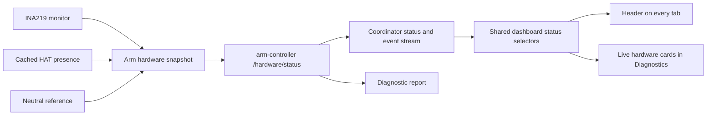

# Shared arm hardware status

The arm-controller service owns one `ClawCurrentMonitor` (INA219 at 0x41), one
`HatPresence` cache (PCA9685 at 0x40), and the recorded neutral reference.
`hardware_status.py` builds a read-only snapshot of those objects under the arm I/O
lock. It never opens a bus, reads registers, writes PWM, or clears faults.

The coordinator reads `/hardware/status` independently of the manual-control
configuration. Its `hardware` field is authoritative; the top-level `claw_current`,
`servo_hat`, and `neutral_evidence` fields mirror it for compatibility. Manual and
commissioning snapshots in the same workbench response share that current sample.
Hardware failure produces unavailable status rather than retaining an old manual
snapshot. Manual configuration failure does not hide a responding sensor.

`DiagnosticsReport.hardware` contains the snapshot used for its hardware checks,
including sample sequence/session and timestamps. Other device/service checks retain
their slower diagnostic polling. The live hardware cards use the event stream so
switching to Diagnostics does not substitute a five-second-old reading for the
header's current sample. `/diagnostics` uses cached HAT presence; the standalone
`hat_check` utility remains available for explicit maintenance.

## Reading health, power and motion inhibition

These are separate facts:

- `reading_state`: `ok`, `error`, `stale` or `unavailable`; `reading_healthy` indicates
  valid fresh readings. Missing or failed conversions do not establish power-off.
- `power_state`: `off`, `energized` or `unknown`. Physical off classification requires
  the configured measured voltage **and absolute shunt** bounds. Mock inference is
  explicitly simulated. A low voltage alone without a valid baseline stays unknown.
- `reset_required` and `fault`: a latched interlock remains after readings recover.
  `healthy` continues to describe readiness of the current monitor for movement,
  so it remains false while that interlock is latched.

For example, fresh valid readings inside the off baseline can have
`reading_state=ok`, `power_state=off`, `reset_required=true`, and `healthy=false`.
The UI shows **Sensor responding**, **Powered off**, and separately **Motion
inhibited — reset required**. It does not call the sensor unavailable. Neutral
reference assessment reports supply off rather than comparing an unpowered circuit
to recorded powered-neutral values. This never establishes measured joint position.

The controller still enforces the 300 ms sensor freshness deadline, absolute 2.5 A
cutoff when the scale is verified, continuous monitoring, shutdown attempts and
explicit power-off fault reset. Reading a status endpoint or opening a page does not
reset anything or retry motion. Raw shunt readings and unverified-scale labels remain
mandatory when resistance has not been externally verified.

`current.ts` supplies the shared frontend selectors and renderers. Both the header
and Diagnostics age the same received sample continuously. A one-second presentation
grace covers brief transport delays only; an explicit backend read error takes effect
immediately, and the grace never changes controller authorization. Retained raw values
cannot continue to claim power-off after updates expire. HAT cache validity expires
at three seconds and never implies that servos are powered or motion is commissioned.

## Regression checks and historical fault

Integration tests cover all reading states, recovered readings with a latched fault,
physical off-baseline requirements, cached projections with no extra I/O, status
independence from manual configuration, and diagnostic export consistency. Browser
tests check all tabs, loss of updates, immediate read errors, and visible reset notices.

The live mismatch investigated on 2026-10-24 contained valid off readings and a
persisted `Stale INA219 readings` latch. Recent launcher logs did not contain enough
timing evidence to identify the original interruption. The display fix does not
claim to resolve that interruption, clear the latch, or relax monitoring deadlines.
