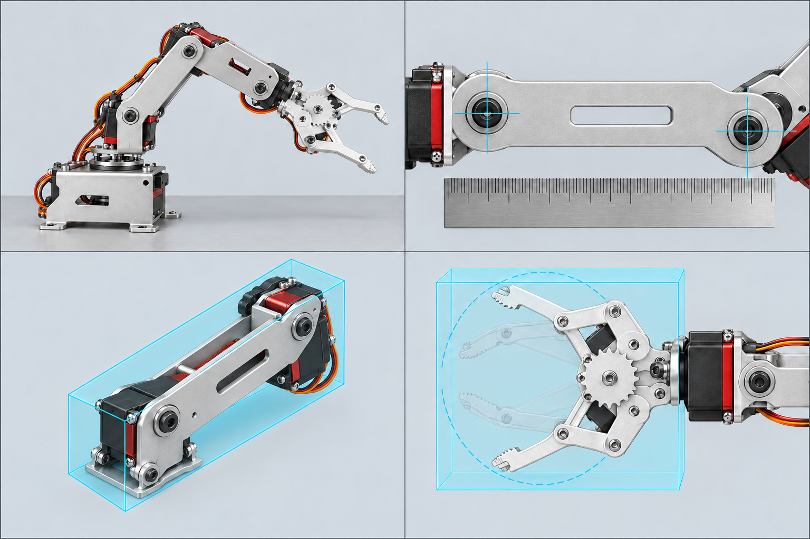

# Initialization measurement illustrations

The dashboard uses `apps/dashboard/public/images/measurement-guide.png`, generated
with the built-in imagegen tool using `dfrobot-rob0036.jpg` as the appearance reference.
The four panels show a reference pose, bearing centres, a collision box, and the
claw sweep. They are schematic illustrations, not measured dimensions or proof of
the assembled arm's pose at 1500 µs. CSS presents the individual panels without
modifying the saved image. Exact coordinate diagrams and labels live in the shared
`apps/dashboard/public/images/measurement-*.svg` assets.

## Generation prompt

Use case: scientific-educational. Create a clean technical illustration sheet for a robotic arm measurement guide using the attached DFRobot ROB0036 V2 photo as a mechanical appearance reference. Four equal rectangular panels in a strict 2 by 2 grid, no gutters, pale cool-gray background. No text, letters, numbers, dimensions, arrows, or logos anywhere. Top left: side view of the complete silver six-servo desktop arm on a flat tabletop, base at left, open claw at right, bent elbow raised, show all joints and mounting brackets clearly, neutral illustrative pose only. Top right: close-up of one silver arm link between two circular pivot centres, side view, ruler held parallel nearby without any numbers, emphasize exact centre of circular bearings. Bottom left: isolated silver servo bracket link in three-quarter view surrounded by a translucent cyan rectangular collision bounding box with all brackets and servo body enclosed, roomy margins. Bottom right: overhead view of the claw mechanism with open fingers, faint ghosted closed fingers and translucent cyan enclosing box covering the full sweep. Accurate connected machinery, consistent silver metal and black/red servo housings. Crisp educational product drawing with restrained shading; no hands, no decorative objects. Each subject must fit well within its own quadrant, with at least 8 percent padding on every panel edge. Landscape overall sheet.

## Measurement conventions

New ROS model measurements may use the table/base-axis intersection as base origin,
X along neutral reach, Y left when looking along X, and Z upward. Place each child
link origin at its attaching joint pivot and align frames at zero; RPY is then zero
by choice of frame, even for sloped links. This is guidance, not an automatic rewrite
of saved models. Verify actual rotation shafts and signs. Joint origins use parent
frames; box centres and rotations use their link frames, while dimensions use the
box axes. tool0 is an explicitly chosen datum.
The rotation diagram is a side view from −Y: +X points right, +Z points up,
and +Y points into the page (a circled cross), so +X × +Y = +Z.
Use the recorded 1500 µs zero pose for joint origins; inspect the full claw sweep
separately for its conservative envelope.

Capsule measurements instead use fixed table-frame millimetres, channels 1–5 at
1500 µs, and the measured claw full-open pulse. Existing measured angle samples
remain limited to channels 1–4 and retain the same API representation. Nominal
manufacturer references never populate observed angles or establish acceptance.

The nominal mappings come from https://wiki.dfrobot.com/rob0036/ (checked
2026-10-27): base 500–2500 µs → 0–270°, other five servos → 0–180°. These are
shaft specifications, not assembled-joint limits or claw opening measurements.

Review generated artwork against these conventions when replacing it. Use mock
mode for UI validation. Powered measurements must retain the repository's continuous
INA219 monitoring, fault shutdown, and verified/unverified current-scale handling.

## Oriented collision boxes

A ROS collision box has three independent inputs:

| Input | Coordinates | Dashboard units |
| --- | --- | --- |
| `links[].size` | Full extents along the box's own X/Y/Z axes | Inches |
| `links[].xyz` | Box centre relative to the link origin, along link axes | Inches |
| `links[].rpy` | Box orientation relative to the link frame | Degrees |

Saved JSON uses metres and radians. The Xacro writes `xyz` and `rpy` to both
`collision/origin` and `visual/origin`; `size` goes to `geometry/box`. This follows
[the official ROS collision-origin example](https://github.com/ros/urdf_tutorial/blob/ros2/urdf/07-physics.urdf).
Joint `rpy` is separate: it determines the child frame relative to its parent at
zero. Rotating a collision box does not change the joint axis or joint frame.
All boxes move with their links; a link-aligned box is not a world-fixed box.

For new measurements, align box X with the component's length, box Y across its
width, and box Z through its thickness. Enclose brackets, servo housings and the
complete claw sweep. Measure the centre in **link** coordinates, and use box RPY
to align the box with the component. A sloping component can have a long narrow
rotated box rather than a larger box aligned with the table.

Example only: for a 10 × 2 × 1 inch component tilted 30° upward in link X/Z, with
its starting-end centre at the link origin, use size `(10, 2, 1)`, centre
`(5 cos 30°, 0, 5 sin 30°)` ≈ `(4.3301, 0, 2.5)` inches, and box RPY
`(0, -30, 0)` degrees. The negative pitch rotates box +X toward link +Z.

`p_link = box_centre + R_box × p_box`, with
`R_box = Rz(yaw) Ry(pitch) Rx(roll)` using column vectors.

Existing schema-version-1 boxes without `rpy` retain zero rotation. Explicit null
or incomplete rotations are allowed in drafts but rejected as complete geometry.
Existing dimensions and joint transforms are never automatically reinterpreted.

## Shared measurement graphics

The documentation and dashboard reference the same SVG files so their frames,
labels and measurement conventions stay consistent. Select a diagram in the UI
to enlarge it. The generated illustration sheet is schematic, not measured data.

## Clearing optional pulse limits

Clear min / Clear max stages an endpoint deletion; Undo restores its field and
Save limits persists the edit. Blank fields without an explicit clear still mean
"leave unchanged" for compatibility with partial updates. The API accepts
`clear_minimum` and `clear_maximum` booleans per joint; setting and clearing the
same endpoint is rejected. Other joints/endpoints remain intact. Clearing never
commands motion. Missing endpoints use the existing nominal Jog fallback when
its configuration next loads; deletion does not establish safe travel.

## Orientation revision prompt (built-in imagegen)

Edit only the bottom-left panel of this four-panel robotics measurement sheet. Preserve the top-left arm, top-right bearing-centre ruler, and bottom-right claw panels exactly. In bottom-left, replace the upright oversized cyan bounding box with a slim oriented translucent cyan rectangular prism whose LONG axis follows the diagonal long axis of the silver arm component, from its lower-left bearing toward its upper-right bearing. The box must tilt with the link, have perpendicular faces, and fully enclose its servo bodies and brackets. Show the entire box within the bottom-left quadrant. Keep the background, silver mechanical appearance, line style, and panel boundaries. No labels, numbers, text, or arrows. This illustrates a ROS collision box rotated relative to its link frame.
